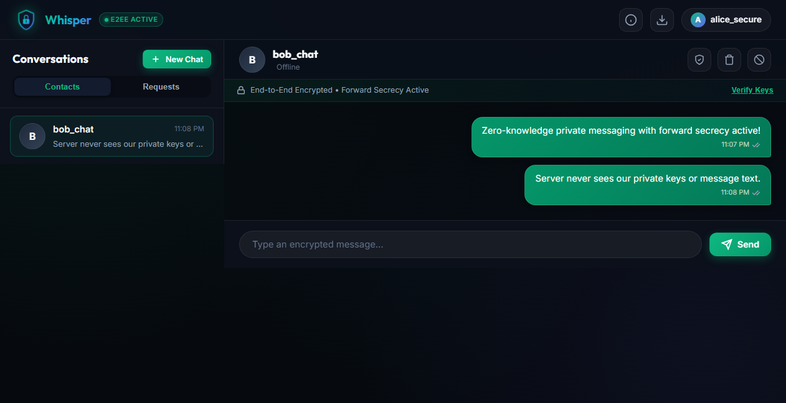
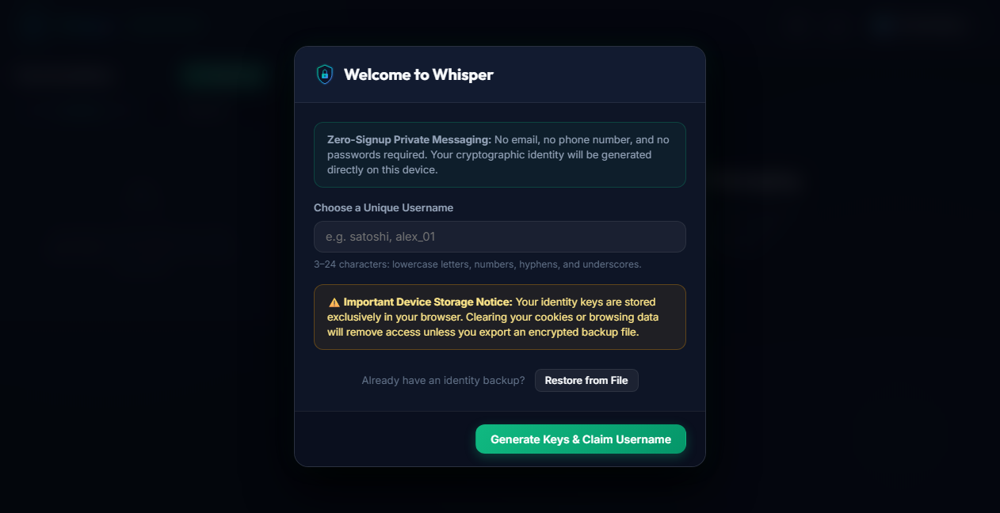
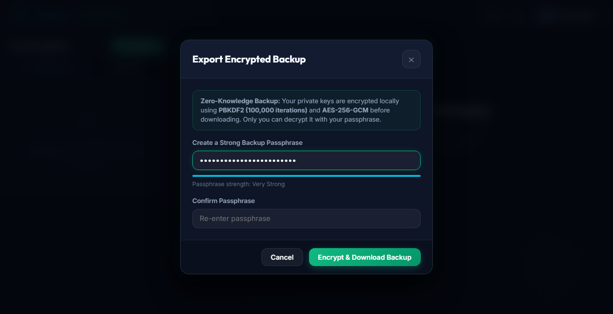
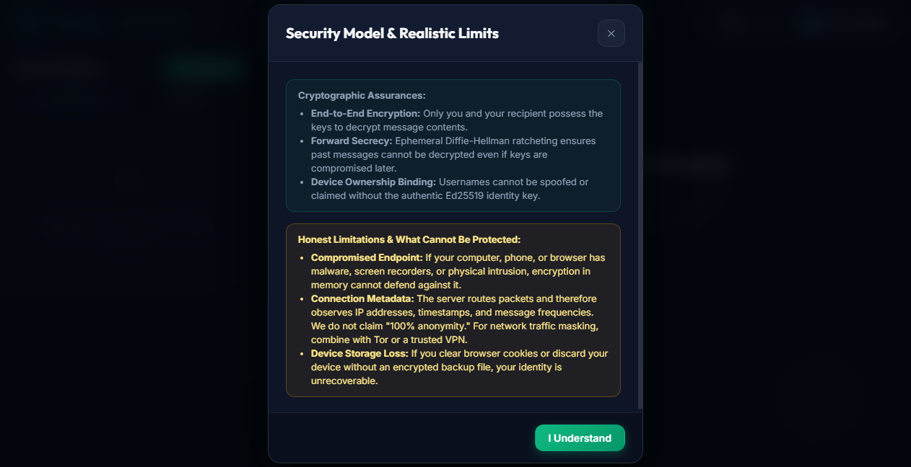
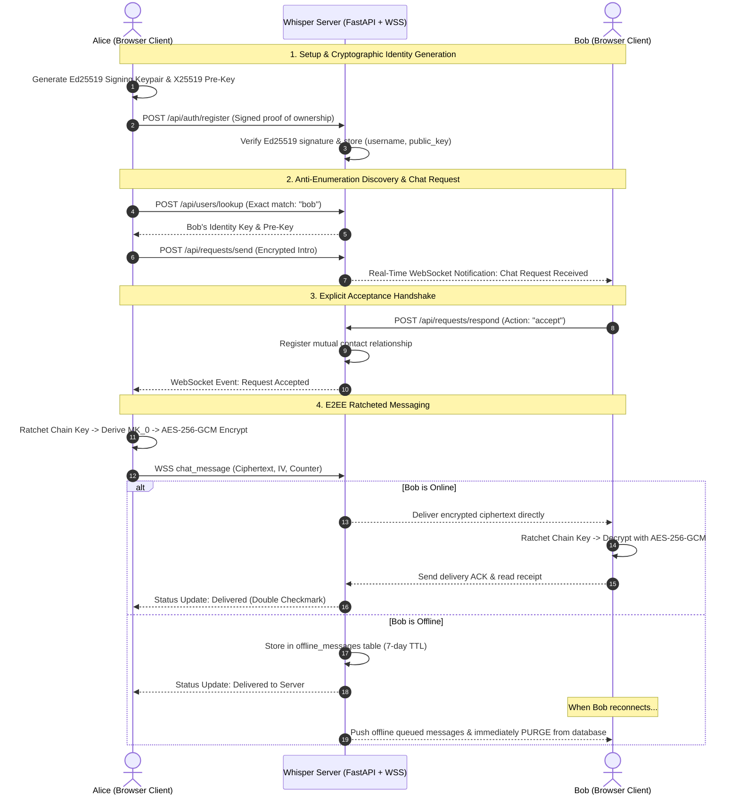

# Whisper — Zero-Signup End-to-End Encrypted Private Messenger

<p align="center">
  
</p>

<p align="center">
  <strong>Private, instant, browser-based messaging with zero signups, zero phone numbers, and zero logins.</strong><br>
  Built on client-side Ed25519 identity ownership, Ephemeral Diffie-Hellman ratcheting for forward secrecy, and AES-256-GCM authenticated encryption.
</p>

<p align="center">
  
  
  
  
  
</p>

---

## 📸 Interface Preview

<div align="center">
  <h3>Active End-to-End Encrypted Chat</h3>
  
</div>

<br>

<div align="center">
  <table>
    <tr>
      <td width="50%" align="center">
        <strong>First-Visit Zero-Signup Setup</strong><br>
        
      </td>
      <td width="50%" align="center">
        <strong>Encrypted Passphrase Backup</strong><br>
        
      </td>
    </tr>
    <tr>
      <td colspan="2" align="center">
        <strong>Transparent Security Model & Limits Disclosure</strong><br>
        
      </td>
    </tr>
  </table>
</div>

---

## ⚡ Key Highlights

- 🛡️ **Zero Sign-Up & Zero Login:** No phone number, email address, password, or third-party OAuth.
- 🔑 **Cryptographic Identity Ownership:** Your username is bound to a persistent **Ed25519 signing key** generated on your device. Proof of ownership is strictly required via digital signature to reconnect or recover—nobody can claim an existing handle simply by typing it.
- 🔒 **End-to-End Authenticated Encryption:** Ciphertexts are sealed client-side with **AES-256-GCM** using unique 96-bit random IVs and authenticated tags. The server never receives plaintext or private keys.
- 🔄 **Forward Secrecy & Break-in Recovery:** Implements Signal-style **Ephemeral Diffie-Hellman ratcheting** (Curve25519 + HMAC-SHA256). Compromise of future keys cannot decrypt past messages.
- 🤝 **Explicit Chat Requests:** Anti-spam by design. Direct messaging begins **only after** the recipient explicitly accepts an encrypted chat request.
- 📬 **Zero-Knowledge Offline Mailbox:** When a contact is offline, messages are queued with a defined 7-day TTL and are **permanently deleted immediately upon delivery acknowledgement**.
- 🔢 **Safety Numbers & QR Verification:** 60-digit deterministic fingerprints and instant QR verification codes protect against active man-in-the-middle attacks, with automated warnings if a contact's key changes.
- 💾 **Passphrase-Protected Encrypted Backup:** Export your private keys into an encrypted `.enc` bundle using **PBKDF2 (100,000 iterations)** and **AES-256-GCM**. Restore seamlessly across browsers.
- 🚫 **Anti-Enumeration Protections:** Strict exact-match username discovery with sliding-window rate limiting prevents user harvesting.

---

## 📊 Comparative Analysis: Whisper vs. Other Messengers

| Feature / Dimension | **Whisper** | **Signal** | **Session** | **Matrix (Element)** | **SimpleX Chat** | **Telegram** (Secret) | **WhatsApp** |
| :--- | :---: | :---: | :---: | :---: | :---: | :---: | :---: |
| **No Phone or Email Required** | :white_check_mark: | :x: (Phone Req.) | :white_check_mark: | Varies | :white_check_mark: | :x: (Phone Req.) | :x: (Phone Req.) |
| **Zero Signup / Instant Access** | :white_check_mark: | :x: | :white_check_mark: | :x: | :white_check_mark: | :x: | :x: |
| **E2EE by Default** | :white_check_mark: | :white_check_mark: | :white_check_mark: | Optional | :white_check_mark: | :x: (Opt-in only) | :white_check_mark: |
| **Forward Secrecy** | :white_check_mark: | :white_check_mark: | :white_check_mark: | :white_check_mark: | :white_check_mark: | :white_check_mark: | :white_check_mark: |
| **Device-Bound Key Ownership** | :white_check_mark: | Server Directory | Public Key | Homeserver Key | Queue Address | Server Token | Central Server |
| **Immediate Mailbox Purge** | :white_check_mark: | :white_check_mark: | 14-day Swarm | :x: (Stored) | :white_check_mark: | N/A | :white_check_mark: |
| **Native Web Browser Support** | :white_check_mark: | :x: | Limited | :white_check_mark: | :x: (CLI/Mobile) | :white_check_mark: | Companion |
| **Passphrase Encrypted Export** | :white_check_mark: | :x: | 12-Word Seed | Recovery Key | Export File | Cloud Password | Cloud Key |

*For complete benchmarks and deep-dive comparisons, see [COMPARISON.md](COMPARISON.md).*

---

## 🏛️ System Architecture & Data Flow



---

## 🚀 Quick Start Guide

### Prerequisites
- Python 3.10+ (Tested on Python 3.14)
- Any modern web browser (Chrome, Edge, Firefox, Safari)

### Installation
```bash
# Clone the repository
git clone https://github.com/vikrant-project/whisper-private-messenger.git
cd whisper-private-messenger

# Install backend dependencies
pip install fastapi uvicorn pynacl cryptography httpx pytest
```

### Running Locally
```bash
# Start the application server
python run.py
```
Open your browser at **`http://localhost:8000`**.

---

## 🧪 Comprehensive Automated Test Suite

Whisper includes an automated unit and integration test suite covering identity ownership, replay protection, encryption integrity, and contact lifecycles:

```bash
# Execute full test suite
python -m pytest tests -v
```

### Test Suite Coverage:
- `test_auth_ownership.py`: Signature proof verification, duplicate handle rejection, challenge-response re-authentication, impersonation prevention.
- `test_unauthorized.py`: Unauthenticated access rejection, token forgery detection, challenge replay attacks, offline mailbox isolation.
- `test_crypto_e2ee.py`: Ed25519 signature tampering, X25519 Curve25519 Diffie-Hellman agreement, AES-256-GCM AEAD encryption, forward secrecy ratchet simulations, deterministic safety numbers.
- `test_requests_lifecycle.py`: Premature messaging prevention before acceptance, request dispatch and acceptance, contact blocking and unblocking.
- `test_recovery.py`: PBKDF2 (100,000 rounds) key derivation, AES-GCM backup encryption/decryption, wrong passphrase rejection.

---

## 🔒 Threat Model & Honest Limitations

In strict adherence to sound security engineering, Whisper makes **no false claims of "100% security" or "absolute anonymity"**:
1. **Endpoint Integrity:** End-to-end encryption cannot defend an endpoint compromised by spyware, operating system backdoors, or hardware keyloggers.
2. **Metadata Transparency:** The central server observes network-layer metadata (IP addresses, connection times, message sizes) in order to route packets. Users desiring network traffic masking should access Whisper via Tor or a trusted VPN.
3. **Storage Persistence:** Browser cache clearance will destroy local IndexedDB keys. The passphrase-encrypted recovery file must be exported to guarantee restoration.

*For complete threat models and vulnerability disclosure protocols, see [ARCHITECTURE.md](ARCHITECTURE.md) and [SECURITY.md](SECURITY.md).*

---

## 📂 Repository Structure

```
.
├── app/
│   ├── config.py            # Environment, retention rules, rate-limit thresholds
│   ├── database.py          # SQLite schema, async queries, WAL mode
│   ├── crypto_utils.py      # Ed25519 signature checks, HMAC token issuance
│   ├── security.py          # Sliding-window rate limiter, token guard
│   ├── websocket_manager.py # Real-time routing, offline queue, presence
│   ├── main.py              # FastAPI server, CSP security headers, lifecycle
│   └── routes/
│       ├── auth.py          # Challenge generation, registration, verify
│       ├── users.py         # Exact anti-enumeration lookup, prekeys
│       ├── requests.py      # Chat requests, acceptance, blocking
│       └── messages.py      # HTTP message fallback, offline mailbox, ack
├── static/
│   ├── index.html           # Responsive dark-glassmorphic SPA
│   ├── css/
│   │   ├── style.css        # Rich tokens, micro-animations, typography
│   │   └── responsive.css   # Mobile, tablet, and desktop breakpoints
│   ├── js/
│   │   ├── crypto/
│   │   │   ├── nacl.min.js     # TweetNaCl audited cryptographic engine
│   │   │   ├── nacl-util.min.js# TweetNaCl encoding utilities
│   │   │   ├── e2ee.js         # Ephemeral DH ratchet, AES-GCM, safety numbers
│   │   │   └── recovery.js     # PBKDF2 (100,000 rounds) + AES-GCM backup
│   │   ├── storage.js          # IndexedDB wrapper for keys, contacts, ratchets
│   │   ├── api.js              # REST + WebSocket client with challenge auth
│   │   ├── ui.js               # UI controller with strict XSS escaping
│   │   ├── qrcode.min.js       # QR code generator for safety number scanning
│   │   └── app.js              # State machine & application orchestrator
│   └── assets/
│       ├── logo.svg            # Glowing shield brand asset
│       └── active_chat_screenshot.png # High-resolution interface preview
├── tests/
│   ├── conftest.py             # Isolated SQLite test fixture & key factory
│   ├── test_auth_ownership.py  # Proof of ownership tests
│   ├── test_unauthorized.py    # Anti-tampering & replay tests
│   ├── test_crypto_e2ee.py     # Cryptographic primitive & ratchet tests
│   ├── test_requests_lifecycle.py # Acceptance & blocking lifecycle tests
│   └── test_recovery.py        # Backup & restore encryption tests
├── ARCHITECTURE.md          # Architectural & cryptographic specification
├── COMPARISON.md            # Deep technical comparison vs 6 major platforms
├── SECURITY.md              # Security bounds & vulnerability policy
├── run.py                   # Local application launcher
└── LICENSE                  # MIT License
```

---

## 📜 License

Licensed under the [MIT License](LICENSE).
